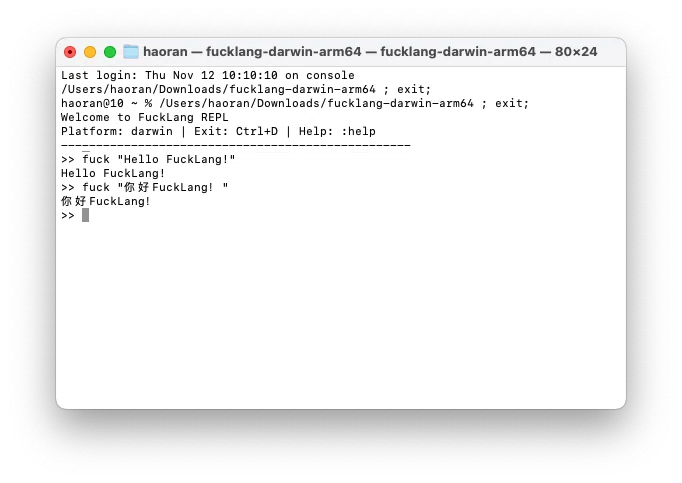

# FuckLang

> A lightweight, Turing-complete scripting language where the keywords are English profanity.
<picture>
  <source media="(prefers-color-scheme: dark)" srcset="images/FuckLangDemo-Dark.png">
  
</picture>
---

## Overview

FuckLang is a small, cross-platform interpreted language. It was built with a simple goal: prove that a language doesn't need a massive ecosystem or complex syntax to be Turing-complete and actually fun to write. It supports variables, control flow, functions, closures, arrays, and hashes, while stripping away unnecessary punctuation.

The interpreter is written in Go, meaning it compiles down to a single, dependency-free binary for macOS, Linux, and Windows.

---

## Features

- **Turing Complete** — Variables, `damn` (if/else/else-if), `hell` (while loops) and `orgy` (C-style for loops) with `break` and `fk` (continue), and recursion
- **First-Class Functions** — Define anonymous or named functions with `bitch`, return with `ass`
- **Closures** — Functions capture their lexical scope
- **Data Structures** — Arrays `[1, 2, 3]` and Hashes `{"key": "value"}` with index read/write, including hash key insertion
- **Namespaces** — `str.`, `arr.`, `file.` group related built-ins behind a hash
- **Assertions** — `wtf cond [, msg]` aborts with a clear message on failure
- **Compound Assignment** — `+=`, `-=`, `*=`, `/=`, with or without a leading `shit`
- **Boolean Aliases** — `bullshit` (true) and `nobullshit` (false)
- **Built-in Functions** — `len`, `push`, `pop`, `slice`, `keys`, `values`, `contains`, `type`, `suck` (stdin), `fucking` (formatted print), `fuckoff` (exit), plus `str.*`, `arr.*`, `file.*` namespaces
- **Error Handling** — Syntax errors are collected with line numbers; runtime errors abort with a clear message, **a line number**, and the offending source line with a caret
- **Comments** — `//` line comments
- **String Escapes** — `\"`, `\\`, `\n`, `\t`, `\r`
- **REPL** — Interactive shell with multi-line block support (bracket-balanced input, `//` comments skipped), meta commands, and persistent history
- **Multi-Architecture** — Pre-compiled binaries for x86_64, ARM64 (Linux/macOS/Windows), RISC-V (Linux), and **LoongArch64 (Linux)**
- **Cross-Platform** — Native binaries for macOS (Intel & Apple Silicon), Linux, and Windows; test suite runs reliably in CI

---

## Usage

Create a file named `hello.fuck`:

```fuck
shit name = "world"
fuck "hello " + name
```

Run it via the CLI:

```bash
./fucklang hello.fuck
```

Or launch the interactive REPL:

```bash
./fucklang
```

The REPL supports multi-line blocks: if you open `{`, `(` or `[`, it keeps reading until brackets are balanced. The prompt shows the current bracket depth (e.g. `..1`). Line comments (`//`) are ignored during bracket balancing, so a `{` inside a comment won't trap you.

### REPL meta commands

```text
:help / :h / :?     Show help
:env                List environment variables
:ast <expr>         Print AST of an expression (indented tree)
:type <expr>        Show the type of an expression
:time <expr>        Measure evaluation time
:history            Show input history
:clear              Clear the current multi-line input buffer
:cls / :clr         Clear the screen
:quit / :q / :exit  Save history and quit
```

Exit with `:quit`, or `Ctrl+D` on Unix / `Ctrl+Z` then `Enter` on Windows. History is stored at `~/.fucklang_history` (last 1000 entries).

---

## Syntax Cheatsheet

| Feature | Keyword / Syntax | Example |
| :--- | :--- | :--- |
| Variable | `shit` | `shit x = 42` |
| Print | `fuck` | `fuck x` |
| Condition | `damn` / `else` / `else damn` | `damn x > 5 { fuck "big" } else { fuck "small" }` |
| While Loop | `hell` | `hell x < 10 { shit x = x + 1 }` |
| For Loop | `orgy` | `orgy shit i = 0; i < 10; i += 1 { fuck i }` |
| Break | `break` | `hell true { damn x > 3 { break } }` |
| Continue | `fk` | `hell i < 5 { shit i += 1; damn i == 2 { fk }; fuck i }` |
| Function | `bitch` | `bitch add(a, b) { ass a + b }` |
| Anonymous Function | `bitch(...)` | `shit f = bitch(x) { ass x * 2 }` |
| Return | `ass` | `ass a + b` |
| Array | `[...]` | `shit a = [1, 2, 3]` |
| Hash | `{...}` | `shit h = {"name": "Alice"}` |
| Index Read | `x[i]` | `fuck arr[0]` / `fuck user["name"]` |
| Index Write | `x[i] = v` | `arr[0] = 9` / `user["role"] = "admin"` |
| Member Access | `x.field` | `str.len("hi")` / `arr.push(a, 1)` |
| Compound Assign | `+=` `-=` `*=` `/=` | `x += 1` / `shit x -= 2` |
| Assert | `wtf` | `wtf x > 0, "x must be positive"` |
| Boolean | `bullshit` / `nobullshit` | `shit ok = bullshit` |
| Comment | `//` | `// this is a comment` |
| Statement Separator | `;` (optional) | `shit x = 5; fuck x` |

### Break and Continue

`break` exits the innermost enclosing loop immediately. `fk` skips to the next iteration. Neither can cross a function boundary, and using either outside any loop is a runtime error.

```fuck
shit i = 0
shit sum = 0
hell true {
    damn i >= 5 {
        break
    }
    shit sum = sum + i
    shit i = i + 1
}
fuck sum    // 10
```

```fuck
shit i = 0
shit sum = 0
hell i < 5 {
    shit i = i + 1
    damn i == 3 { fk }
    shit sum = sum + i
}
fuck sum    // 12
```

### For Loop

```fuck
shit total = 0
orgy shit i = 1; i <= 5; i += 1 {
    damn i == 3 { fk }
    shit total += i
}
fuck total    // 12
```

### Index Assignment

Both arrays and hashes support index assignment. For hashes, assigning to a new key inserts it:

```fuck
shit arr = [1, 2, 3]
arr[1] = 20
fuck arr[1]          // 20

shit user = {"name": "Alice"}
user["role"] = "admin"
fuck user["role"]    // admin
fuck len(user)       // 2
```

### Assertions

```fuck
wtf x > 0
wtf x > 0, "x must be positive"
```

If the condition is falsy, evaluation aborts with `wtf: <message>`. With no explicit message, the default is `assertion failed`.

### Else If

```fuck
shit n = 5
damn n > 10 {
    fuck "big"
} else damn n > 3 {
    fuck "medium"
} else {
    fuck "small"
}
```

### Namespaces

```fuck
fuck str.len("hello")               // 5
fuck str.upper("abc")               // ABC
fuck str.split("a,b,c", ",")        // [a, b, c]

fuck arr.slice([10, 20, 30], 1, 3)  // [20, 30]
fuck arr.contains([1, 2], 2)        // true

fuck file.exists("go.mod")          // true
fuck file.read("go.mod")
fuck file.write("out.txt", "hello")
```

---

## Built-ins

### Top-level

| Name | Signature | Description |
| :--- | :--- | :--- |
| `len` | `len(x)` | Length of String, Array, or Hash |
| `push` | `push(arr, v)` | Append `v` to Array `arr` **in place**; returns the same array |
| `type` | `type(x)` | Returns the type name as a String (e.g. `"INTEGER"`, `"HASH"`) |
| `suck` | `suck()` | Read one line from stdin as a String |
| `fucking` | `fucking(fmt, ...)` | `fmt.Sprintf`-style formatted print |
| `fuckoff` | `fuckoff(code [, msg])` | Exit with an integer code, optional message on stderr |

### `str`

| Name | Signature | Description |
| :--- | :--- | :--- |
| `str.len` | `str.len(s)` | Length in bytes |
| `str.upper` | `str.upper(s)` | Uppercase |
| `str.lower` | `str.lower(s)` | Lowercase |
| `str.trim` | `str.trim(s)` | Trim surrounding whitespace |
| `str.split` | `str.split(s, sep)` | Split into an Array of Strings |
| `str.contains` | `str.contains(s, sub)` | Substring test |
| `str.replace` | `str.replace(s, old, new)` | Replace all occurrences |
| `str.join` | `str.join(arr, sep)` | Join an Array of Strings |

### `arr`

| Name | Signature | Description |
| :--- | :--- | :--- |
| `arr.len` | `arr.len(a)` | Length |
| `arr.push` | `arr.push(a, v)` | Append (mutates) and return `a` |
| `arr.pop` | `arr.pop(a)` | Remove and return the last element |
| `arr.slice` | `arr.slice(a, i, j)` | Sub-array `[i:j]` |
| `arr.contains` | `arr.contains(a, v)` | Membership test |
| `arr.keys` | `arr.keys(h)` | Hash keys as an Array |
| `arr.values` | `arr.values(h)` | Hash values as an Array |

### `file`

| Name | Signature | Description |
| :--- | :--- | :--- |
| `file.read` | `file.read(path)` | Read whole file as a String |
| `file.write` | `file.write(path, content)` | Write String to file (0644) |
| `file.exists` | `file.exists(path)` | Existence check |

---

## Semantics Notes

Some behaviours that are intentional but easy to be surprised by:

- **Integers only.** All numbers are signed 64-bit. `/` is integer division (`5 / 2 == 2`). There are no floats.
- **`push` mutates in place.** `shit b = push(a, 1)` makes `a` and `b` refer to the same array.
- **Loop variables are captured by reference.** Closures created inside a `hell` loop share the same loop variable. If you need per-iteration capture, copy the variable into a fresh binding inside the loop body.
- **Hash printing order is unspecified.** `Hash.Inspect` iterates a Go map, so key order is not stable. Do not rely on it.
- **Array index assignment does not grow the array.** `arr[i] = v` requires `0 <= i < len(arr)`; out-of-bounds writes are runtime errors.
- **`break` and `fk` cannot cross a function boundary.** Using them inside a function body that is called from a loop is a runtime error, not a loop exit.
- **No immediate function invocation.** You cannot call an anonymous function directly (e.g., `bitch() { ... }()` is a syntax error). Assign it to a variable first, then call it.
- **Namespaces are reserved.** `str`, `arr` and `file` are keywords, not ordinary identifiers. Do not use them as variable names.

---

## Testing & CI

The project has two layers of tests:

1. **Evaluator logic tests** (`tests/tests_test.go`) — inline source snippets covering arithmetic, strings, comments, conditions (including `else if`), variables, built-ins, hashes, index assignment, functions, closures, argument-count errors, loops, `break`, `fk`, `orgy`, `wtf`, compound assignment, boolean aliases, and namespaces.
2. **Black-box `.fuck` tests** — every `tests/*.fuck` file is executed, its stdout is captured, and compared byte-for-byte against the matching `tests/*.expected` file. Syntax errors, runtime errors, and output mismatches all fail the test.

To run the tests locally:

```bash
go clean -testcache
go test -v ./...
```

> **Line endings matter.** `.fuck` and `.expected` files are compared byte-for-byte, so they must be checked out with LF. The repository's `.gitattributes` enforces `eol=lf` for both extensions. If you edit them on Windows, make sure your editor doesn't save CRLF.

CI runs the full test suite on **Ubuntu** (GitHub Actions) for fast, deterministic feedback. After tests pass, a separate job cross-compiles binaries for Linux (x86/ARM/RISC-V/**LoongArch64**), Windows (x86/ARM), and macOS (Intel/Apple Silicon), and uploads them as artifacts.

---

## Build from Source

Requires Go 1.21 or later.

```bash
git clone https://github.com/CaoHaoran-Dev/FuckLang.git
cd FuckLang
go build -o fucklang ./cmd/fucklang
```

To cross-compile the binaries for all supported architectures:

```bash
# Linux
GOOS=linux   GOARCH=amd64   go build -o fucklang-linux-amd64      ./cmd/fucklang
GOOS=linux   GOARCH=arm64   go build -o fucklang-linux-arm64      ./cmd/fucklang
GOOS=linux   GOARCH=riscv64 go build -o fucklang-linux-riscv64    ./cmd/fucklang
GOOS=linux   GOARCH=loong64 go build -o fucklang-linux-loong64    ./cmd/fucklang

# Windows
GOOS=windows GOARCH=amd64   go build -o fucklang-windows-amd64.exe ./cmd/fucklang
GOOS=windows GOARCH=arm64   go build -o fucklang-windows-arm64.exe ./cmd/fucklang

# macOS
GOOS=darwin  GOARCH=amd64   go build -o fucklang-mac-amd64        ./cmd/fucklang
GOOS=darwin  GOARCH=arm64   go build -o fucklang-mac-arm64        ./cmd/fucklang
```

Or use the Makefile:

```bash
make build     # local build
make test      # clean test cache and run all tests
make release   # cross-compile all platforms into build/
make clean     # remove build artifacts
```

---

## Project Layout

```text
.
├── cmd/fucklang/main.go          # CLI entry + REPL
├── internal/
│   ├── ast/ast.go                # AST nodes
│   ├── token/token.go            # Token types + keywords
│   ├── lexer/lexer.go            # Lexer (comments, line tracking, escapes)
│   ├── parser/parser.go          # Pratt parser + error collection
│   ├── evaluator/
│   │   ├── evaluator.go          # Tree-walking evaluator
│   │   ├── builtins.go           # Aggregation entry point
│   │   ├── builtins_core.go      # len / push / type
│   │   ├── builtins_io.go        # suck / fucking / fuckoff
│   │   ├── builtins_str.go       # str.* namespace
│   │   ├── builtins_arr.go       # arr.* namespace
│   │   └── builtins_file.go      # file.* namespace
│   └── object/object.go          # Runtime values
├── tests/
│   ├── *_test.go                 # Logic tests + black-box runner
│   ├── *.fuck                    # Black-box programs
│   └── *.expected                # Expected stdout for each .fuck
├── .github/workflows/            # CI (Ubuntu tests + cross-compile)
├── .gitattributes                # LF normalization for .fuck / .expected
├── Makefile
├── go.mod
└── README.md
```

---

## Contributing

Contributions are welcome!

1. Fork the repository.
2. Create a feature branch (`git checkout -b feature/AmazingFeature`).
3. Commit your changes (`git commit -m 'Add some AmazingFeature'`).
4. Push to the branch (`git push origin feature/AmazingFeature`).
5. Open a Pull Request.

If you add a new `.fuck` black-box test, remember to also add the matching `.expected` file — otherwise `TestFuckFiles` will fail with a "missing expected file" error.

This project is licensed under the [MIT License](LICENSE).